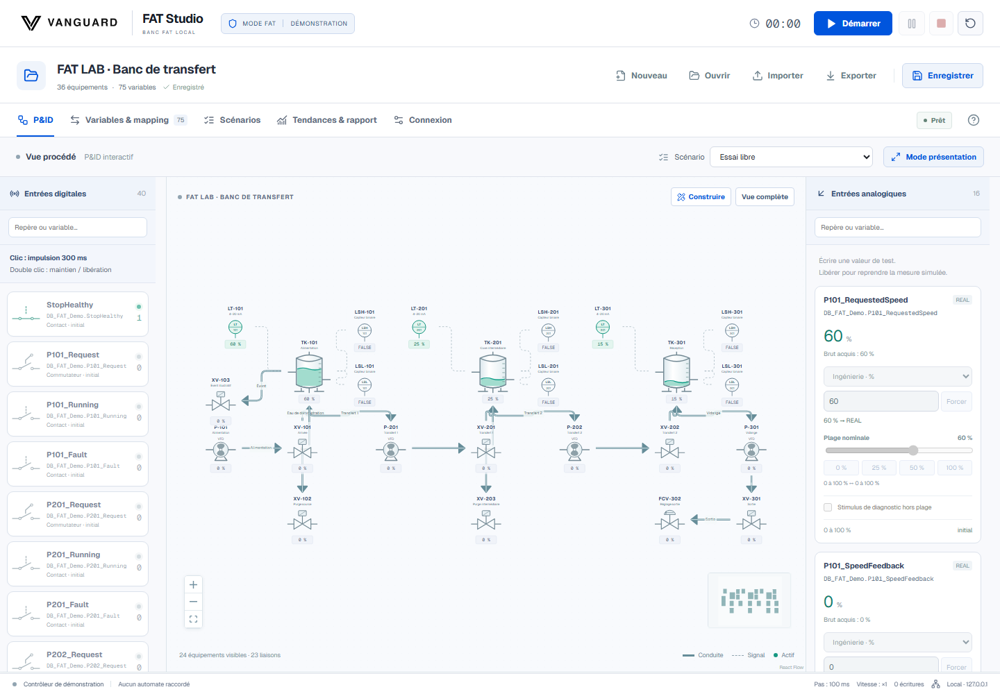

<picture>
  <source media="(prefers-color-scheme: dark)" srcset="frontend/public/brand/logo_vanguard_wordmark_horizontal_white.png">
  
</picture>

# Vanguard FAT Studio

**Un banc local pour tester un programme PLC avant d’avoir l’installation sous la main.**

Reliez une CPU virtuelle à un procédé simulé. Envoyez vos entrées, suivez les commandes et les retours sur le P&ID, puis rejouez le scénario ou déroulez la FAT pas à pas. Le code du banc est gratuit et sous [licence MIT](LICENSE).

[Essayer la démo](#essayer-sans-siemens) · [Connecter PLCSIM](#connecter-tia-portal-et-plcsim) · [Utiliser Codex ou Claude](#utiliser-codex-ou-claude) · [Voir la vidéo](https://github.com/vandervan0001/Vanguard-FAT-Studio/releases/tag/public-preview-2026-11-04) · [Contribuer](#contribuer)

## Essayer sans Siemens

1. Sous Windows, [téléchargez le portable indiqué en tête de la release](https://github.com/vandervan0001/Vanguard-FAT-Studio/releases/tag/public-preview-2026-11-04) et extrayez tout le ZIP dans un nouveau dossier. Python est inclus.
2. Ouvrez le dossier **Vanguard-FAT-Studio**, puis double-cliquez sur **Vanguard-FAT-Studio.cmd**. La démo fonctionne sans automate ni TIA Portal.
3. Dans [le banc local](http://127.0.0.1:8765), ouvrez la **démo laboratoire** et choisissez le scénario **Alimentation de la cuve source**. Cliquez sur **Préparer la vue**, puis sur **Démarrer**.

La démo fournit trois cuves, quatre pompes, huit vannes et 75 variables. Le programme de démonstration fournit les commandes et le banc simule les niveaux et retours. Essayez un stimulus analogique de 12 mA et suivez le résultat dans les tendances.

Pour dessiner votre propre procédé, créez un projet puis choisissez **Insérer un circuit de remplissage** dans **P&ID → Construire**. Sélectionnez un équipement et ouvrez **Lier les tags automate** pour rechercher les variables compatibles, proposer des associations depuis le repère ou créer les tags manquants. [Parcours détaillé](docs/USER_GUIDE.md#7-créer-le-pid-et-ses-variables)

Pour travailler depuis les [sources](https://github.com/vandervan0001/Vanguard-FAT-Studio/archive/refs/heads/main.zip), installez Python 3.12 x64. Le lanceur Windows prépare les dépendances verrouillées au premier démarrage ; sous Linux ou macOS, lancez `bash scripts/start.sh`. Le [guide d’installation](docs/INSTALLATION.md) couvre les mises à jour et les kits hors ligne.

## Connecter TIA Portal et PLCSIM

Le banc échange en OPC UA avec une cible virtuelle autorisée. Le programme PLC commande le procédé. Le banc lit ses sorties et écrit les entrées simulées déclarées dans le mapping. Sur le P&ID, vous pouvez associer une animation à l’état d’un tag et retrouver la mesure, l’adresse PLC et le NodeId dans la table de variables.

| À tester | Dans le banc |
| --- | --- |
| Bouton, capteur ou défaut | Impulsion ou maintien BOOL. Stimulus analogique en points PLC, unités d’ingénierie, pourcentage ou signal électrique selon le profil. |
| Séquence reproductible | Scénario temporisé avec écritures et contrôles attendus, ou FAT pas à pas avec stimuli préparés et observation du testeur. |
| Relecture d’un essai | Tendances, rapport HTML, traces CSV et preuves JSON. Archive `.fat.zip` pour restaurer un projet et son historique dans un nouveau dossier. |

La démo a passé **31 attentes sur 31** lors de la campagne sur TIA Portal V21 et S7-PLCSIM Advanced V8. Le testeur renseigne le verdict FAT. Le P&ID sert à simuler les interactions du procédé, dans les limites du modèle décrit dans la documentation. [Configurer PLCSIM](docs/PLCSIM_SETUP.md) · [Projet TIA de démonstration](docs/DEMO_PLC.md) · [Modèle de procédé](docs/MODEL.md) · [Preuve de la campagne](evidence/reprises/2026-11-03-public-demo/final-live/VERIFICATION.md)

## Utiliser Codex ou Claude

Donnez à votre assistant le dossier du projet, vos règles de programmation et le [prompt de démarrage](docs/AI_QUICKSTART.md). Il peut préparer du code PLC à relire, créer des scénarios à partir des formats JSON et piloter le banc via le CLI ou l’API locale. L’accès d’ingénierie TIA exposé à l’assistant est en lecture seule. Le banc n’a pas besoin de clé API de modèle. [Contrat CLI et API](docs/AI_CONTROL.md) · [Formats JSON](docs/FORMAT.md)

## Guides

- [Guide utilisateur](docs/USER_GUIDE.md) pour les pupitres, le P&ID, les scénarios et les rapports.
- [Archives de projet](docs/PROJECT_ARCHIVES.md) pour sauvegarder, transférer et restaurer une FAT.
- [Compatibilité TIA](docs/TIA_VERSIONS.md) pour distinguer les profils V20 et V21 et leur niveau de vérification.
- [Reprendre les sources](README-CODEX.md) pour construire et tester le banc.

## Contribuer

Si vous trouvez un problème, indiquez votre version de TIA ou le mode démo, les étapes pour le reproduire et ce que vous attendiez. Un scénario minimal sans programme client ni secret aide à reproduire le problème. Les pull requests sont les bienvenues. [Ouvrir une issue](https://github.com/vandervan0001/Vanguard-FAT-Studio/issues) · [Consignes de contribution](AGENTS.md)

Le code original de Vanguard FAT Studio est sous MIT. Les composants tiers conservent leurs licences. TIA Portal et PLCSIM s’installent séparément. [Licence MIT](LICENSE) · [Notices tierces](THIRD_PARTY_NOTICES.md)
