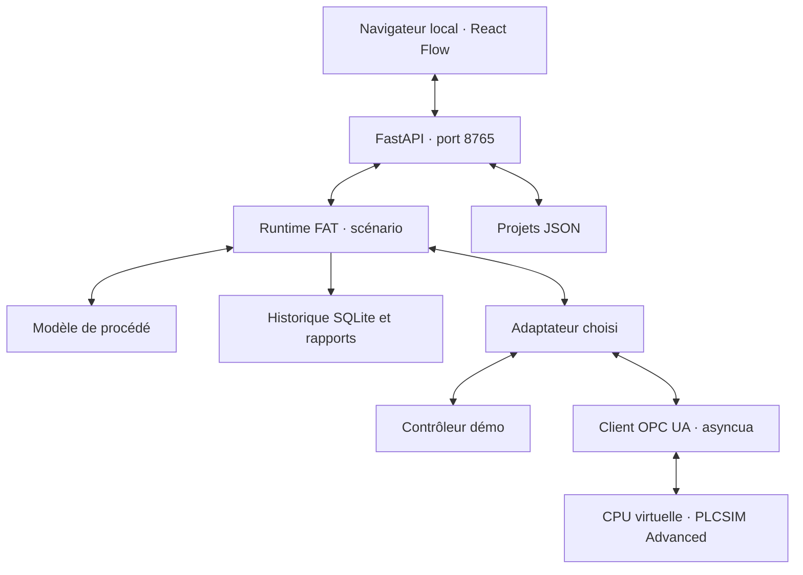
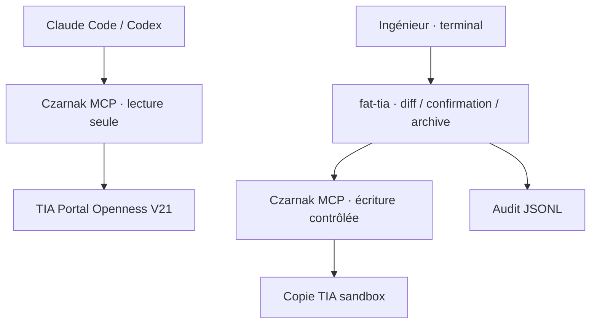

# FDS — FAT Studio 0.1.0

## Architecture

Un seul adaptateur est instancié. En mode OPC UA, le contrôleur démo n'est pas construit. Le navigateur ne communique pas directement avec OPC UA. Les assets, icônes et polices système fonctionnent hors ligne.

Le volet TIA utilise un autre processus et un autre protocole :

Les opérations d'écriture du CLI ne sont ni un serveur MCP, ni des routes HTTP. La configuration des clients IA ne donne pas accès à ce CLI. Ce modèle de permissions suppose que l'ingénieur ne donne pas volontairement des capacités shell équivalentes à un autre agent.

## Structure du code

| Fichier / dossier | Responsabilité |
| --- | --- |
| `fat_studio/models.py` | Schéma strict, validation des limites, mappings et scénarios |
| `fat_studio/catalog.py` | Types de symboles, ports, paramètres, plages et défauts |
| `fat_studio/engine.py` | Procédé déterministe et contrôleur de démonstration séparé |
| `fat_studio/runtime.py` | Ordre des échanges, cadence, état d'essai et scénarios |
| `fat_studio/adapters` | Démonstration et OPC UA ; aucune API de commande CPU |
| `fat_studio/security.py` | Politique locale, endpoint exact et identité autorisée |
| `fat_studio/storage.py` | Écriture atomique des projets et preuves SQLite |
| `fat_studio/reporting.py` | Exports sans service externe |
| `fat_studio/app.py` | API locale, protection d'origine et interface précompilée |
| `frontend` | Source de l'interface ; dépendances npm verrouillées |
| `integrations/tia_engineering.py` | Réutilisation du MCP TIA et flux humain d'import/compilation |

## Cycle d'exécution

À chaque pas :

1. Appliquer les actions de scénario dues au début du pas.
2. Lire **l'ensemble des commandes PLC** et vérifier qualité, type et bornes.
3. Calculer le procédé pour `step_ms / 1000` secondes simulées.
4. Construire un lot contenant exactement les entrées simulées autorisées ; valider l'intégralité du lot avant tout envoi.
5. Écrire le lot avec les types OPC UA explicites.
6. Enregistrer valeurs, qualité, temps UTC et temps simulé ; évaluer les assertions dues sur l'image fraîche.

Une erreur arrête la boucle, ferme la session, marque les valeurs mauvaises et conserve l'essai. Aucune reconnexion automatique n'a lieu. Une écriture partielle est signalée comme telle : le logiciel ne prétend pas annuler des valeurs déjà appliquées au serveur.

Les écritures de l'API de contrôle sont sérialisées. Un verrou distinct protège le runtime pendant les échanges. Une pause/arrêt répond seulement après l'arrêt du cycle actif ; aucun lot supplémentaire ne peut être émis après la réponse.

Chaque remplacement du projet calcule une révision SHA-256 de son JSON canonique. Les réponses API qui renvoient un projet fournissent `X-FAT-Project-Revision` ; l'état de supervision contient `project_id` et `project_revision`. L'interface mémorise la révision seulement après une réponse projet réussie, jamais à partir du polling. Elle joint `X-FAT-Project-ID` et `X-FAT-Project-Revision` aux commandes d'essai, forçages, défauts, marqueurs, verdicts et aux modifications du projet ou du mapping. Le serveur vérifie ces valeurs sous le verrou des mutations et refuse un contexte périmé en HTTP 409, y compris pour deux versions du même projet. Le brouillon local reste disponible avant rechargement. Les imports et chargements explicites sélectionnent un projet sans comparer la révision précédente. Les en-têtes de contexte restent facultatifs pour les autres clients API ; un client qui les omet doit coordonner lui-même ses modifications. Le jeton de session reste obligatoire pour toute mutation.

### Horloges

Le modèle est à pas fixe de 20 à 2 000 ms. Valeur de départ : 100 ms. La vitesse est de 1× en OPC UA et peut aller de 0,1× à 20× en démo. Si un cycle est trop lent, la boucle n'envoie pas de rafale pour rattraper son retard ; elle journalise le dépassement. Ce n'est ni un ordonnanceur temps réel dur ni un couplage synchrone avec le cycle CPU.

Les actions sont quantifiées au prochain début de pas. Les assertions sont évaluées à la première image terminée dont le temps atteint leur date. Prévoir au moins un pas entre une injection et une assertion qui doit en constater l'effet. La fin d'un scénario pause le banc et ferme la communication. Le verdict utilisateur reste `not_evaluated` jusqu'à sa saisie explicite.

## Modèle et équipements

Le modèle utilise des litres et litres/seconde pour le volume et les débits ; le niveau est un pourcentage. Il suppose une cuve de section constante. Les sorties sont bornées par le volume disponible et les débordements sont comptabilisés.

Les pompes/vannes possèdent des groupes de débit explicites. Les éléments d'un même groupe en série transportent le minimum des capacités ; les groupes indépendants s'additionnent. Les temps de réponse sont des retards du premier ordre. La vanne modulante utilise les caractéristiques existantes d'HistorianSim, avec une condition de fermeture étanche à zéro.

Le modèle ne couvre pas les pressions, pompes centrifuges détaillées, réseaux ramifiés arbitraires, thermodynamique ou énergies résiduelles. Le sens du dessin et les groupes de débit doivent être cohérents, mais la géométrie du dessin ne calcule pas les débits.

Les entrées non associées à un symbole peuvent servir aux essais manuels ; elles sont signalées par un avertissement. Deux producteurs d'une même entrée sont interdits. Plusieurs consommateurs d'une même commande PLC sont possibles ; le contrôleur démo refuse des commandes contradictoires sur un même tag.

## Mapping et types

Le sens est toujours exprimé vu du PLC : `input` = valeur simulée écrite vers PLC ; `output` = commande lue depuis PLC. Les outputs ne peuvent pas être déclarés `writable`.

| Type projet | Type OPC UA | Plage de stockage |
| --- | --- | --- |
| BOOL | Boolean | true / false |
| INT | Int16 | −32 768 à 32 767 |
| DINT | Int32 | −2 147 483 648 à 2 147 483 647 |
| REAL | Float | IEEE-754 simple précision, valeurs finies |

Le modèle valide strictement les booléens et entiers sans convertir une chaîne ou `true` en nombre. Les bornes d'ingénierie sont distinctes des plages du type. Un défaut hors plage peut dépasser les premières, jamais les secondes.

La validation locale s'exécute sur chaque démarrage. La session OPC UA vérifie ensuite existence, namespace, scalarité, type, droits et duplications résolues. Aucun accès au namespace système 0 n'est permis dans le mapping FAT.

## Frontière locale

- Le lanceur n'accepte que des adresses d'écoute loopback.
- L'API vérifie Host, Origin et les requêtes cross-site.
- Toute mutation exige un jeton de session aléatoire ; il n'est pas une authentification multi-utilisateur.
- Le serveur ne sert aucun répertoire arbitraire et les identifiants de projet sont bornés.
- La politique machine ne vient jamais d'un import de projet et n'est pas éditable par HTTP.
- Une connexion OPC UA utilise une IP privée explicite, un endpoint exact, une ApplicationUri approuvée et, en mode sécurisé, une empreinte de certificat.
- Les références aux certificats/variables d'environnement sont également épinglées dans la politique locale.
- Le mode sans chiffrement exige une autorisation locale distincte ; aucun identifiant utilisateur n'y est accepté par le client.

Ces contrôles préviennent les erreurs d'usage. Ils ne prétendent pas défendre un poste déjà contrôlé par un attaquant ayant les droits de l'utilisateur ou une politique machine volontairement mal configurée.

## Persistance, reprise et preuves

Les projets sont écrits dans un fichier temporaire vidé sur disque puis remplacés atomiquement. L'état précédent existe sous forme de sauvegarde JSON. Les identifiants restent stables et le format se prête à Git.

Chaque essai garde une copie du projet et du scénario, les horodatages, toutes les valeurs/qualités par cycle, les événements, défauts et conclusions. Les tendances d'écran sont limitées à 600 points espacés de 0,5 s ; ce plafonnement ne retire aucun échantillon des exports.

Un export demandé pendant un essai représente un instantané fini. Avant les en-têtes HTTP, une seule requête SQLite capture les métadonnées de l'essai, le nombre d'échantillons et les derniers identifiants d'échantillon et d'événement inclus. Les exports CSV/JSON parcourent ensuite ce préfixe via une connexion dédiée en lecture seule, sans charger toutes les mesures en mémoire. Les cycles et événements ajoutés pendant le téléchargement restent exclus. Le JSON expose `snapshot:{captured_at,last_sample_id,last_event_id}` et un `sample_count` cohérent avec les mesures exportées ; le rapport HTML affiche l'instant de capture UTC.

Un verrou de dossier empêche deux serveurs de partager les mêmes preuves. Après une interruption du processus, un essai non clôturé est marqué `interrupted` ; il n'est jamais repris automatiquement. Un projet illisible est conservé intact et l'interface charge une démonstration de récupération avec un message explicite.

Une défaillance du stockage des preuves, notamment un disque plein, arrête les échanges et ferme la session. La cause reste visible même si sa journalisation échoue : l'événement d'erreur de secours, conservé en mémoire, porte alors `details.persisted:false`. Ce secours ne garantit aucune persistance après fermeture. Les derniers échantillons, événements ou le statut final peuvent ne pas avoir été enregistrés ; les données déjà validées sur disque restent disponibles. Le logiciel ne présente pas un événement en mémoire comme une preuve archivée.

Le HTML est autonome et échappe les textes utilisateur. Le CSV des résultats neutralise les chaînes susceptibles d'être interprétées comme une formule de tableur. Le CSV de mapping reste un format d'échange exact destiné à l'application ; les cellules ne sont jamais exécutées par FAT Studio.

## Qualification

La suite automatisée exécute le moteur, le runtime/API, les fichiers, de vrais clients/serveurs OPC UA sur localhost et le transport MCP avec un serveur de test. Les parcours Playwright pilotent la distribution réelle et son API. Le protocole d'acceptation Siemens reste distinct : aucune preuve obtenue avec la fixture ne doit être appelée « FAT Siemens réussie ».
