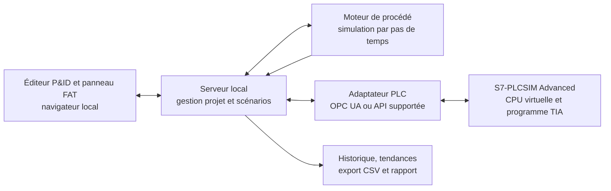

# URS — Banc FAT local avec P&ID interactif et PLCSIM Advanced

**Type de document :** User Requirements Specification (URS) — version de consultation 0.1  
**Destinataire :** Bureau d’intégration / automatisme / logiciel industriel  
**Statut :** Base de cadrage pour étude de faisabilité, chiffrage et proposition technique

---

## 1. Objet du document

Le présent document définit les besoins utilisateurs pour une application locale de simulation destinée à préparer et exécuter des FAT (Factory Acceptance Tests) de programmes d’automates Siemens.

L’application doit permettre à un automaticien de représenter simplement un procédé sous forme de P&ID interactif, d’associer ses équipements et instruments aux variables d’un automate virtuel, puis de tester le programme PLC en faisant évoluer un modèle simplifié du procédé.

Ce document constitue une URS initiale, et non une spécification fonctionnelle détaillée (FDS) ni une spécification de conception logicielle. Le prestataire devra confirmer les hypothèses, les interfaces supportées et les critères de performance lors de la phase de faisabilité.

## 2. Résumé exécutif

Le besoin est de créer un petit banc FAT local, réutilisable et versionnable par Git, comprenant :

1. un éditeur graphique très simple pour construire un P&ID de test par glisser-déposer ;
2. une bibliothèque limitée de symboles de procédé et d’instruments ;
3. un mécanisme d’association entre ces objets, les tags de simulation et les variables d’un DB d’échange PLC ;
4. un modèle de procédé simplifié, exécuté en boucle pendant le test ;
5. une interface de communication locale avec S7-PLCSIM Advanced ;
6. des commandes de test, des forçages contrôlés, des tendances et un export des résultats.

L’application doit tester le **programme PLC existant**. Elle n’a pas pour objectif de générer ou de remplacer la logique automate. Le principe est le suivant : le modèle de procédé reçoit les sorties PLC (commandes de pompe, position de vanne, consignes), calcule l’évolution du procédé, puis renvoie au PLC les valeurs simulées des capteurs.

## 3. Finalité et objectifs métier

### 3.1 Finalité

Permettre à une équipe d’automatisme ou d’intégration de réaliser, sur un poste local, des essais fonctionnels répétables avec un programme Siemens exécuté dans PLCSIM Advanced, sans devoir mobiliser l’installation réelle et sans mettre en place une plateforme de simulation de procédé de grande ampleur.

### 3.2 Objectifs

- Tester séquences, permissifs, interverrouillages, alarmes et réactions aux défauts.
- Visualiser les états PLC dans un P&ID compréhensible par les automaticiens et, si nécessaire, par un client en FAT.
- Injecter des valeurs de capteurs, des défauts et des scénarios de test de manière contrôlée.
- Réutiliser des modèles d’équipements et des scénarios dans plusieurs projets.
- Garder les projets, les associations de tags et les scénarios sous contrôle de version.
- Produire un enregistrement exploitable des tests et de leurs résultats.

## 4. Utilisateurs et contexte d’utilisation

### Utilisateurs principaux

- automaticien / programmeur PLC ;
- ingénieur de mise en service ;
- intégrateur réalisant ou préparant un FAT ;
- éventuellement client participant à une démonstration ou à une revue FAT.

### Contexte visé

- application exécutée sur un poste Windows compatible avec les versions installées de TIA Portal et S7-PLCSIM Advanced ;
- fonctionnement sur le même poste que PLCSIM Advanced en première version ;
- utilisation locale, sans dépendance au cloud et sans connexion à un réseau de production ;
- connexion à une instance PLC virtuelle unique en MVP.

La compatibilité exacte du modèle de CPU, du firmware, de TIA Portal et de PLCSIM Advanced devra être confirmée avant le développement de l’interface PLC.

## 5. Périmètre

### 5.1 Inclus dans le MVP

- création et édition d’un P&ID de test simple ;
- palette réduite d’équipements ;
- association explicite des tags P&ID aux variables de simulation ;
- sauvegarde et rechargement d’un projet local ;
- modèle dynamique simplifié d’un petit procédé ;
- lecture/écriture d’une liste autorisée de variables sur l’automate virtuel ;
- visualisation des valeurs, états, alarmes et tendances ;
- forçage manuel et injection de défauts de simulation ;
- exécution, pause, remise à zéro et répétition d’un scénario ;
- export des valeurs et du rapport de test ;
- volet d’assistance d’ingénierie optionnel via un client IA choisi par l’utilisateur (Claude Code et/ou Codex) et un serveur MCP TIA évalué ; consultation du code, aide à l’analyse, proposition de modifications et compilation contrôlée dans une copie du projet.

Le volet MCP/IA constitue un flux d’ingénierie distinct du runtime FAT. Sa présence et son niveau d’accès en écriture seront confirmés après la preuve de faisabilité et l’approbation sécurité.

### 5.2 Hors périmètre initial

- génération automatique d’un projet TIA Portal ou de blocs PLC ;
- remplacement de TIA Portal, PLCSIM Advanced ou SIMIT ;
- simulation physique haute fidélité ou modèle détaillé de mécanique 3D ;
- outil de dessin P&ID pour ingénierie de construction ou documents « as-built » ;
- calcul hydraulique général couvrant n’importe quel réseau ;
- validation de fonctions de sécurité, de SIL, d’analyse de risques ou de conformité machine ;
- accès à un automate de production ou commande d’équipements réels en MVP ;
- simulation distribuée multi-PLC ou multi-postes en MVP.

L’application est une aide au test fonctionnel. Elle ne constitue pas une preuve de sécurité ni une certification de l’installation.

## 6. Principe d’architecture demandé

L’interface utilisateur ne doit pas communiquer directement avec le PLC depuis le navigateur. Un service local doit gérer les communications, la validation des écritures et l’état de connexion.

### 6.1 Technologies indicatives

Le prestataire peut proposer des alternatives, à condition de justifier leur compatibilité avec PLCSIM Advanced et leur facilité d’installation hors ligne.

- **Interface :** application web locale, accessible via `localhost`, avec SVG ou technologie équivalente pour le P&ID interactif.
- **Serveur local :** service léger sur le même poste ; architecture séparant l’interface, le moteur de simulation et l’adaptateur PLC.
- **Moteur de simulation :** Python est une option à évaluer, notamment pour réutiliser ou adapter certains modèles d’HistorianSim.
- **Adaptateur PLC :** preuve de faisabilité préalable pour sélectionner l’interface supportée : OPC UA lorsque disponible/configuré, ou API Siemens applicable à la version retenue de PLCSIM Advanced.
- **Intégration assistant IA (optionnelle) :** serveur MCP séparé, basé sur l’API officielle TIA Portal Openness ou une implémentation existante auditée, exposé au client Claude Code/Codex choisi. Ne pas confondre le MCP d’ingénierie TIA avec l’adaptateur d’exécution FAT vers PLCSIM Advanced.
- **Persistance :** fichiers JSON lisibles et stables pour la description du P&ID, les propriétés, les tags et les scénarios ; données de test exportables en CSV.
- **Versionnement :** projets de test compatibles avec Git, avec identifiants stables et fichiers texte diffables.

Le choix final des langages, bibliothèques, versions et mécanismes d’installation sera documenté par le prestataire dans la proposition technique.

## 6.2 Volet d’assistance IA pour le projet TIA Portal

Ce volet est distinct du moteur de simulation de procédé et de son interface P&ID. Il vise à permettre à l’équipe d’utiliser son propre client d’assistance au développement, notamment Claude Code ou Codex, pour lire/analyser le projet TIA, préparer des modifications et vérifier leur compilation.

### Principe

- Le socle officiel côté Siemens est **TIA Portal Openness**, une API d’automatisation des workflows d’ingénierie.
- Un serveur **MCP** tiers peut exposer des fonctions Openness à un client IA compatible. Les serveurs disponibles sont communautaires ou commerciaux, non équivalents entre eux et dépendants de la version TIA/Openness ; ils doivent être évalués sur le poste et la version réels.
- Le client Claude Code/Codex, le serveur MCP TIA et l’application FAT constituent des composants distincts. Le MCP TIA sert à l’ingénierie du projet ; l’application FAT sert à échanger des valeurs avec l’automate virtuel pendant l’exécution.
- Une installation locale du serveur MCP ne signifie pas que le modèle IA est local : avec un client hébergé, les extraits de projet transmis au modèle peuvent être envoyés au fournisseur du modèle. Cette circulation de code doit être autorisée par la politique de sécurité de l’organisation.

L’intégrateur doit proposer soit un MCP existant, après revue de sa version, de ses fonctions, de sa licence et de son modèle de sécurité, soit un adaptateur contrôlé autour d’Openness. Le choix doit être versionné et documenté. Ne pas présenter un plugin communautaire comme un composant Siemens officiel.

### Opérations IA visées

- lire la structure du projet, les blocs, types de données, tags et références croisées accessibles par l’interface retenue ;
- exporter le code dans une représentation lisible et expliquer ou analyser un bloc ;
- proposer une modification ou générer du code sur instruction de l’ingénieur ;
- importer une modification dans une **copie de développement** du projet après validation humaine ;
- lancer une compilation TIA et restituer les diagnostics ;
- préparer des changements de DB/tags utiles à l’interface FAT, si pris en charge et explicitement autorisé.

La prise en charge exacte des langages (par exemple SCL, LAD/FBD), objets, versions TIA et types de modifications doit être établie par un essai technique. L’IA ne doit pas être supposée capable de lire/éditer toutes les représentations graphiques au même niveau.

### Modèle de contrôle requis

- fonctionnement **lecture seule par défaut** ;
- activation séparée du mode écriture ;
- chaque modification doit être visible comme un diff ou un changement équivalent avant application ;
- sauvegarde/point de restauration avant toute écriture ;
- confirmation explicite d’un ingénieur pour les modifications, imports et compilations ;
- modifications limitées à une copie de développement/sandbox du projet ;
- aucune fonction de téléchargement vers un PLC physique, de mise en RUN/STOP ou de commande en production dans le périmètre ;
- journalisation de la demande, des outils utilisés, des fichiers/blocs affectés, des validations et du résultat de compilation, selon les possibilités techniques et règles de sécurité.

Ce volet vise l’assistance d’ingénierie, pas l’approbation automatique du code. Un automaticien conserve la responsabilité de la revue, de la compilation, du test et de la libération du projet.

## 7. Exigences fonctionnelles

Les identifiants ci-dessous pourront être repris dans la matrice de conformité du prestataire.

### 7.1 Éditeur de P&ID

- **FR-001 — Nouveau projet :** l’utilisateur peut créer, nommer, sauvegarder et recharger un projet de FAT.
- **FR-002 — Édition visuelle :** l’utilisateur peut placer, déplacer, sélectionner, renommer et supprimer des objets dans un canevas.
- **FR-003 — Connexions :** l’utilisateur peut relier les objets par des lignes de procédé avec direction de flux facultative.
- **FR-004 — Bibliothèque initiale :** le MVP inclut au minimum un réservoir/cuve, une pompe, une vanne tout-ou-rien, une vanne modulante, un capteur analogique, un capteur binaire et un indicateur d’état.
- **FR-005 — Propriétés :** chaque objet dispose d’un nom/tag, d’une description facultative, d’unités et de paramètres pertinents pour sa simulation.
- **FR-006 — Représentation d’état :** les équipements affichent de manière lisible leur état PLC et, si disponible, leur état simulé (par exemple marche/arrêt, ouverture, défaut).
- **FR-007 — UX de base :** l’édition doit être utilisable à la souris, avec zoom/panoramique, alignement ou grille facultative et raccourcis clavier essentiels.

Le canevas est un dessin fonctionnel de FAT, pas un outil CAO. La fidélité visuelle doit privilégier la lisibilité plutôt que la conformité à une norme de dessin complète.

### 7.2 Association aux tags PLC

- **FR-008 — DB d’échange :** le système s’appuie initialement sur un DB ou une structure de variables d’échange convenu avec le prestataire et intégré au programme PLC de test.
- **FR-009 — Entrées simulées :** l’application écrit les variables représentant les entrées de procédé du PLC : mesures analogiques, fins de course, états capteurs et défauts simulés.
- **FR-010 — Sorties PLC :** l’application lit les commandes et retours pertinents issus du programme PLC, par exemple commande pompe, commande vanne, consigne et état d’alarme.
- **FR-011 — Types :** le MVP prend en charge au minimum BOOL, INT/DINT et REAL, sous réserve de compatibilité de l’interface retenue.
- **FR-012 — Mapping :** l’utilisateur peut associer chaque objet à une ou plusieurs variables PLC et voir les mappings manquants, invalides ou en conflit.
- **FR-013 — Import/export de mapping :** le mapping est exportable et importable dans un format simple, par exemple CSV ou JSON.
- **FR-014 — Validation :** le système vérifie, avant le démarrage, l’existence et le type des variables mappées dans la mesure permise par l’interface PLC.
- **FR-015 — Écriture autorisée :** l’application n’écrit que les variables explicitement déclarées comme entrées simulées et autorisées dans la configuration de test.

Le MVP ne doit pas supposer une découverte automatique universelle des tags TIA. L’intégrateur doit spécifier la structure de DB proposée et les étapes minimales nécessaires côté projet TIA.

### 7.3 Modèle de procédé

- **FR-016 — Boucle de simulation :** le modèle s’exécute par pas de temps configurables et échange les valeurs avec l’instance PLC pendant l’exécution.
- **FR-017 — Couplage en boucle fermée :** les sorties du programme PLC influencent l’état simulé du procédé ; les capteurs simulés sont renvoyés en entrée au PLC.
- **FR-018 — Modèles d’équipements :** chaque type de symbole fournit un comportement par défaut paramétrable ; les coefficients et limites sont enregistrés dans le projet.
- **FR-019 — Procédé de démonstration :** une première unité de démonstration est proposée, de préférence un réservoir avec alimentation, sortie, mesure de niveau, pompe et vanne. Le cas TK-101 d’HistorianRCA peut être évalué comme référence documentaire, sans être imposé comme procédé final.
- **FR-020 — Fidélité explicitée :** l’interface indique clairement qu’il s’agit d’un modèle simplifié et affiche les paramètres ou hypothèses de simulation importants.
- **FR-021 — Contrôle PLC unique :** lorsque le programme PLC réel est connecté, le modèle de procédé ne doit pas appliquer un second contrôleur sur la même boucle. Le modèle représente le procédé et les équipements ; la logique de contrôle reste dans le PLC testé.

Pour le MVP, le modèle peut utiliser des équations simples et des règles de comportement. Un solveur générique de réseau hydraulique ou une simulation multiphysique détaillée n’est pas requis.

### 7.4 Commandes et scénarios de FAT

- **FR-022 — Contrôle d’exécution :** démarrer, mettre en pause, reprendre, arrêter et réinitialiser le scénario.
- **FR-023 — Forçage manuel :** modifier une valeur simulée avec limites, unités et indication visible de l’état forcé.
- **FR-024 — Injection de défauts :** simuler notamment un capteur figé, un signal hors plage, une vanne bloquée ou un défaut moteur, selon les équipements disponibles.
- **FR-025 — Scénarios sauvegardés :** enregistrer une séquence de valeurs, d’actions ou de défauts avec un nom et une description.
- **FR-026 — Rejouabilité :** permettre de rejouer un scénario dans des conditions initiales comparables et consigner les paramètres utilisés.
- **FR-027 — État des communications :** afficher l’instance PLC connectée, son état, la dernière mise à jour et toute perte de communication.

### 7.5 Tendances et rapports

- **FR-028 — Tendances :** afficher en direct les principales variables simulées et PLC.
- **FR-029 — Journal :** enregistrer au minimum le temps, le nom du tag, la valeur, la qualité/état de communication et les actions utilisateur pertinentes.
- **FR-030 — Export :** exporter les données du test en CSV et produire un rapport synthétique comprenant le projet, le scénario, les tags suivis, les horodatages, les défauts injectés et le résultat utilisateur.
- **FR-031 — Marqueurs :** l’utilisateur peut poser un marqueur ou un commentaire pendant un test.
- **FR-032 — Client IA/MCP :** si le volet IA est retenu, la solution doit documenter une configuration permettant à Claude Code et/ou Codex d’utiliser le serveur MCP validé avec la version TIA cible.
- **FR-033 — Lecture de projet :** l’agent peut, dans les limites de l’interface retenue, consulter le projet ouvert, les blocs, types, tags et diagnostics nécessaires à l’analyse du code et au raccordement du DB FAT.
- **FR-034 — Aide au code :** l’agent peut expliquer, analyser et proposer des modifications au programme ; l’ingénieur doit pouvoir examiner les changements avant leur import dans la copie de développement.
- **FR-035 — Écriture protégée :** tout accès en écriture est désactivé par défaut, activé explicitement, sauvegardé avant modification et soumis à une confirmation humaine.
- **FR-036 — Compilation :** l’agent peut demander une compilation du logiciel PLC dans TIA via l’interface retenue et présenter les erreurs/avertissements retournés ; la compilation ne vaut pas approbation fonctionnelle.
- **FR-037 — Limite d’action :** aucun outil IA ne doit télécharger le projet sur un automate physique, commander une CPU réelle ou déclencher un RUN/STOP dans le cadre de ce projet.
- **FR-038 — Traçabilité IA :** les opérations IA doivent être traçables autant que le permet le serveur retenu ; le prestataire documente les limites de journalisation.
- **FR-039 — Données transmises au modèle :** l’utilisateur doit être averti que les sources, tags ou extraits de projet envoyés au client IA peuvent quitter le poste si le modèle est hébergé. La configuration doit suivre la politique de sécurité approuvée.

## 8. Exigences non fonctionnelles

### 8.1 Local et hors ligne

- **NFR-001 :** le système doit fonctionner sur le poste local sans service cloud.
- **NFR-002 :** aucune donnée de procédé ne doit être envoyée à un service externe.
- **NFR-003 :** l’application doit pouvoir être démarrée par un technicien selon une procédure documentée, sans lancer manuellement plusieurs composants logiciels non documentés.
- **NFR-004 :** les dépendances nécessaires doivent être fournies ou installables selon les règles IT du site ; le mode d’installation hors ligne est à chiffrer.

### 8.2 Performance indicative

Pour le chiffrage initial, viser un petit projet unitaire d’environ 50 équipements et 200 tags au maximum, avec une actualisation visuelle de l’ordre d’une seconde ou meilleure. Le prestataire devra proposer et valider le pas de calcul du modèle et les performances réelles lors du prototype de faisabilité.

### 8.3 Robustesse et utilisabilité

- **NFR-005 :** les erreurs de communication, de mapping et de modèle doivent être visibles et compréhensibles ; aucune erreur ne doit être masquée silencieusement.
- **NFR-006 :** à la perte de communication, l’application signale immédiatement l’état, cesse les écritures et adopte un comportement sûr défini en conception.
- **NFR-007 :** les projets enregistrés doivent être réouvrables après fermeture ou redémarrage de l’application.
- **NFR-008 :** les fonctions d’édition et d’exécution sont distinguées visuellement.

### 8.4 Sécurité et séparation du réel

- **NFR-009 :** l’application est configurée par défaut pour ne communiquer qu’avec l’instance virtuelle locale approuvée.
- **NFR-010 :** aucune connexion à un automate de production n’est activée par défaut.
- **NFR-011 :** avant toute écriture, l’application vérifie l’identité de l’instance ou affiche une confirmation explicite comprenant la cible.
- **NFR-012 :** un mode FAT clairement visible est obligatoire ; un mécanisme prévient l’usage accidentel d’un projet de simulation contre un automate réel.
- **NFR-013 :** l’intégrateur documente les ports, interfaces réseau, certificats et droits requis par l’interface sélectionnée.
- **NFR-014 :** le système ne doit pas être présenté comme dispositif de sécurité, de commande opérationnelle ou d’autorisation de mise en service.

## 9. Approche d’intégration avec PLCSIM Advanced

Siemens documente des options de communication locale et d’intégration de PLCSIM Advanced avec d’autres applications, notamment par TCP/IP, OPC UA ou API selon la configuration et la version. La faisabilité exacte doit être démontrée sur la CPU et les versions réellement retenues ; l’URS ne présume pas que chaque combinaison supporte toutes les interfaces.

Le prestataire doit comparer au minimum :

1. **OPC UA**, si le serveur et les tags de la CPU virtuelle peuvent être exposés et utilisés dans l’environnement cible ;
2. **API S7-PLCSIM Advanced**, si elle est applicable et préférable pour l’accès au process image ou aux variables ;
3. toute autre interface officiellement supportée qu’il recommande.

Le choix doit tenir compte de la stabilité, de la latence, des types de données, de la configuration requise, des licences, de la sécurité et du coût total de maintenance.

## 10. Exploitation possible des dépôts HistorianSim et HistorianRCA

Les deux dépôts identifiés peuvent accélérer l’étude, mais ne constituent pas à eux seuls l’application demandée.

### HistorianSim

Le dépôt décrit un simulateur Python pour procédés chimiques, comprenant des modèles de procédé, des boucles, des instruments et la génération de données d’historien. Il pourrait servir de référence ou de source à évaluer pour le moteur physique. Son fonctionnement décrit est orienté vers la génération de séries temporelles ; il faudrait donc vérifier le code et adapter le modèle à une exécution interactive en boucle fermée avec le PLC. Il est particulièrement important de séparer le procédé des boucles de régulation simulées afin que le PLC testé demeure le seul contrôleur de la boucle.

Le dépôt indique une licence MIT. Toute réutilisation doit faire l’objet d’une revue technique et de licence et conserver les notices requises.

### HistorianRCA

Le dépôt fournit un cas documenté de cuve chauffée à la vapeur, comprenant description de procédé, dictionnaire de tags, schéma SVG et historiques de données simulées. Il peut être utile pour construire un premier scénario de démonstration ou des données de référence ; ce n’est pas, à lui seul, un moteur d’exécution interactif relié à PLCSIM.

Le dépôt indique une licence CC BY 4.0 pour son contenu. Toute réutilisation ou adaptation doit respecter les obligations d’attribution applicables.

**Décision demandée à l’intégrateur :** fournir une courte analyse de réutilisabilité, des composants concernés, des modifications nécessaires, des dépendances, des risques de licence et de la stratégie de maintenance. Ne pas intégrer automatiquement ces dépôts comme dépendances runtime avant cette analyse.

## 11. Proposition de phases de réalisation

### Phase 0 — Faisabilité et preuve de communication

- confirmer CPU, firmware, TIA Portal et version de PLCSIM Advanced ;
- confirmer l’interface de communication PLC de l’application FAT ;
- confirmer la version Openness disponible, les capacités à lire/exporter/modifier les langages PLC utilisés et la compatibilité avec un serveur MCP et les clients Claude Code/Codex ;
- comparer un serveur MCP communautaire existant à un adaptateur dédié ; auditer ses licences, versions, permissions, écritures, confirmations, journaux et dépendances ;
- valider le flux de données vers le modèle IA et obtenir l’approbation sécurité pour le client choisi ;
- lire et écrire un petit ensemble de tags de test ;
- documenter les contraintes de licence, de sécurité et d’installation ;
- fournir une décision d’architecture et un chiffrage détaillé du MVP.

**Critère de sortie :** démonstration fiable d’un échange bidirectionnel entre une appli locale et la CPU virtuelle.

### Phase 1 — MVP autonome hors PLC

- éditeur simple de P&ID ;
- bibliothèque réduite ;
- modèle d’une unité de démonstration ;
- forçages, scénario, tendances et sauvegarde JSON ;
- tests du moteur de procédé indépendants de PLCSIM.

### Phase 2 — Intégration PLCSIM Advanced

- DB d’échange documenté ;
- mapping tags ;
- lecture/écriture contrôlée ;
- diagnostic de communication et verrouillage des écritures ;
- scénario de FAT en boucle fermée avec le programme PLC.

### Phase 3 — Stabilisation et remise

- export CSV et rapport de test ;
- vérifications de sécurité et de comportement en erreur ;
- installateur ou procédure de lancement ;
- documentation utilisateur et technique ;
- transfert de connaissances et remise du code source.

## 12. Critères d’acceptation proposés

Le MVP est accepté lorsque les essais suivants sont réussis et documentés :

1. L’utilisateur crée, sauvegarde, ferme et recharge un P&ID comprenant les objets de la bibliothèque initiale.
2. Les tags sont mappés au DB convenu et les mappings invalides sont signalés avant le démarrage.
3. L’application se connecte à l’instance PLCSIM Advanced convenue et affiche sans ambiguïté la cible.
4. Une valeur d’entrée simulée est écrite et observée par le programme PLC ; une sortie PLC est lue et reflétée sur le P&ID.
5. Un scénario de référence démontre une séquence de procédé en boucle fermée ; le choix de la séquence est approuvé lors de la conception.
6. Un défaut simulé est injecté et ses effets sont visibles sur les variables, les états et l’historique.
7. Une perte de communication est signalée ; l’application cesse les écritures selon le comportement sûr défini.
8. Les données d’un essai sont exportables en CSV et un rapport synthétique peut être généré.
9. Le projet est reproductible à partir des fichiers versionnés et des dépendances documentées.
10. Aucun test d’acceptation ne requiert l’accès à un automate de production.
11. Si le volet IA est retenu, le client Claude Code/Codex peut lister et lire au moins un bloc de test par le serveur MCP approuvé.
12. Une proposition de modification peut être montrée sous forme de diff et rejetée sans altérer le projet.
13. Après approbation explicite, une modification de test peut être importée dans une copie du projet, sauvegardée, compilée dans TIA et ses diagnostics restitués.
14. Il est démontré que le flux ne télécharge pas le projet et ne commande pas une CPU physique.

Les valeurs chiffrées de performance et le jeu de tags de validation seront figés après la Phase 0.

## 13. Livrables attendus du prestataire

- analyse de faisabilité et matrice de compatibilité des versions ;
- architecture logicielle et schéma des flux de données ;
- prototype de communication PLCSIM Advanced ;
- URS mise à jour et FDS approuvée avant réalisation ;
- code source et historique Git ;
- modèle de démonstration et projet FAT d’exemple ;
- définition du DB d’échange et guide de mapping ;
- guide d’installation, de démarrage, d’utilisation et de dépannage ;
- stratégie de gestion des dépendances et des licences open source ;
- si volet IA retenu : matrice de compatibilité TIA/Openness/MCP/client, procédure Claude Code/Codex, modes lecture seule/écriture, schéma de permissions, exigences de validation humaine et consignes de sécurité des données ;
- protocole et résultats des essais d’acceptation ;
- procédure de remise et session de transfert de connaissances.

## 14. Hypothèses et points à confirmer

Les points suivants doivent être levés pendant la Phase 0, avant de figer la conception :

1. modèle exact de CPU simulée, firmware et version de PLCSIM Advanced ;
2. version de TIA Portal et système d’exploitation du poste ;
3. disponibilité et configuration d’OPC UA ou de l’API appropriée ;
4. structure existante du programme et préférence entre DB de simulation dédié ou mapping sur des variables déjà présentes ;
5. procédé retenu pour la démonstration initiale ;
6. nombre de tags et d’objets attendus pour le premier projet réel ;
7. politique IT d’installation locale, de ports réseau et de dépendances ;
8. format du rapport FAT et exigences de traçabilité du client ;
9. réutilisation éventuelle du code HistorianSim et/ou du contenu HistorianRCA après audit ;
10. besoin futur de connexion à un automate physique, à traiter comme extension séparée ;
11. client IA retenu (Claude Code, Codex, les deux ou autre) et politique d’utilisation locale/cloud ;
12. mode MCP autorisé : lecture seule, propositions/diffs, import après approbation ou écriture contrôlée ;
13. langages et types de blocs réellement utilisés dans le programme (SCL, LAD, FBD, GRAPH, autres) et degré d’accès requis ;
14. version cible TIA Portal/Openness et contraintes d’installation du serveur MCP sur le poste de développement.

## 15. Références

- [HistorianSim — dépôt GitHub](https://github.com/ScottDuncanAI/HistorianSim) — simulateur Python et génération de données de procédé ; licence et contenu à vérifier avant réutilisation.
- [Licence MIT de HistorianSim](https://github.com/ScottDuncanAI/HistorianSim/blob/main/LICENSE).
- [HistorianRCA — dépôt GitHub](https://github.com/ScottDuncanAI/HistorianRCA) — cas documenté TK-101, tags, P&ID SVG et jeu de données.
- [Licence de HistorianRCA](https://github.com/ScottDuncanAI/HistorianRCA/blob/main/LICENSE).
- [Siemens — guide de prise en main de S7-PLCSIM Advanced](https://cache.industry.siemens.com/dl/files/660/109739660/att_1366322/v1/109739660_PLCSIM_ADV_GettingStarted_v1.0.2_1.pdf).
- [Siemens — exemple d’utilisation de PLCSIM Advanced et tables de simulation](https://cache.industry.siemens.com/dl/files/047/109759047/att_962042/v3/109759047_PLCSIMAdv_SimTable_DOC_V10_en.pdf).
- [Siemens — manuel officiel TIA Portal Openness en français](https://cache.industry.siemens.com/dl/files/199/109815199/att_1124009/v1/TIAPortalOpeness_frFR_fr-FR.pdf) — API Siemens pour automatiser des workflows d’ingénierie.
- [Czarnak/tia-portal-mcp](https://github.com/Czarnak/tia-portal-mcp) — exemple communautaire de serveur MCP pour TIA Portal V21 ; capacités, mode d’accès et compatibilité à revalider au moment du choix.
- [heilingbrunner/tiaportal-mcp](https://github.com/heilingbrunner/tiaportal-mcp) — autre exemple communautaire à évaluer sur les versions et opérations requises.
- [Czarnak/totally-integrated-claude](https://github.com/Czarnak/totally-integrated-claude) — plugin et flux de travail Claude Code ; vérifier séparément quelles fonctions communiquent réellement avec le projet TIA et lesquelles ne servent qu’à la documentation.
- [Siemens — Eigen Engineering Agent](https://www.siemens.com/en-us/products/tia-portal/eigen-engineering-agent/) — offre Siemens d’assistance IA à l’ingénierie ; à distinguer d’une intégration MCP générique avec le compte Claude Code/Codex de l’utilisateur.

---

**Fin du document — URS version de consultation 0.1**
